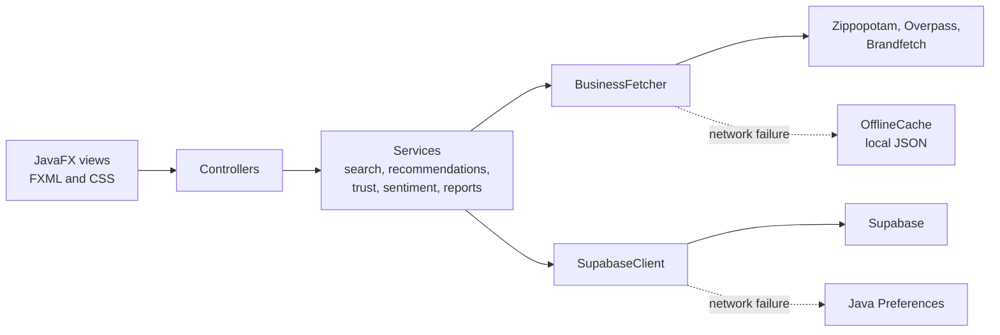

# Trove

**A desktop app that helps people find, review, and support small businesses near them.**

Trove takes a ZIP code, pulls real nearby businesses from OpenStreetMap, filters out big chains, and recommends places based on what you already like. It is written in Java 21 and JavaFX, and it keeps working when the network goes down.

Built by a two-person team ([@arv20](https://github.com/arv20) and [@nave-neptunus](https://github.com/nave-neptunus)) for the FBLA *Byte-Sized Business Boost* Coding & Programming event, 2026.

| | |
|---|---|
| **Language and UI** | Java 21, JavaFX 21, FXML, CSS |
| **Backend** | Supabase (Postgres over REST) with a local fallback |
| **External data** | OpenStreetMap Overpass API, Zippopotam geocoding, Brandfetch logos |
| **Security** | bcrypt password hashing, Google OAuth, macOS Touch ID, reCAPTCHA v2 |
| **Size** | 24 Java classes, about 6,800 lines, 5 FXML views, MVC structure |

## What's worth looking at

If you have two minutes, these are the most interesting parts of the code.

| Problem | Approach | Code |
|---|---|---|
| Answer natural-language questions with no paid AI API | TF-IDF vectors and cosine similarity, written from scratch and run on the device | [`LocalAIConcierge`](src/main/java/com/fbla/businessboost/util/LocalAIConcierge.java) |
| Show how search results relate to each other | Force-directed graph with custom repulsion and damping physics, animated with an `AnimationTimer` | [`GraphVisualizer`](src/main/java/com/fbla/businessboost/util/GraphVisualizer.java) |
| Keep the app usable when the network fails | 1-second network timeouts, then automatic fallback to local storage and a JSON cache | [`SupabaseClient`](src/main/java/com/fbla/businessboost/util/SupabaseClient.java), [`OfflineCache`](src/main/java/com/fbla/businessboost/util/OfflineCache.java) |
| Turn raw map data into useful listings | Geocode the ZIP, query Overpass, then infer tags, price level, and descriptions from OSM metadata | [`BusinessFetcher`](src/main/java/com/fbla/businessboost/util/BusinessFetcher.java) |
| Limit fake reviews | Rate limiting, a proof-of-work challenge, and trust scores that weight each rating | [`ReviewTrustEngine`](src/main/java/com/fbla/businessboost/util/ReviewTrustEngine.java) |
| Recommend without other users' data | Content-based scoring against the tags of a user's favorites | [`RecommendationEngine`](src/main/java/com/fbla/businessboost/util/RecommendationEngine.java) |
| Run web-only sign-in flows in a desktop app | Embedded local HTTP server that hosts reCAPTCHA and receives the OAuth redirect | [`CaptchaServer`](src/main/java/com/fbla/businessboost/util/CaptchaServer.java) |

## How it fits together



Network calls fail in a predictable way: each service catches connection errors and switches to local data, so a lost connection never freezes the interface.

## Features

- **Discover:** search by ZIP code, filter by category, sort by rating, and save favorites.
- **My Impact:** live charts of your activity, with PDF and HTML report export.
- **Smart Search:** concierge Q&A, tag filters, and an interactive relationship graph.
- **Leaderboard:** ranks community members by impact score, streak, and category.
- **Reviews:** keyword-based sentiment scoring across service, price, vibe, and quality, plus a warning when a star rating contradicts the written review.
- **Coupons:** single-use redemption codes with expiration countdowns.
- **Accessibility:** one-click dark and high-contrast theme.

## Known limitations

- Login compares bcrypt hashes in the client. A production version should move authentication to a server or to Supabase Auth, with row-level security on every table.
- The walking route planner creates a sample itinerary and does not compute an optimal route.
- Some leaderboard and review content is seeded sample data for demonstrations.
- There is no automated test suite yet.

## Run it

Requires Java 21 or newer on macOS or Linux.

```bash
git clone https://github.com/nave-neptunus/FBLA_TROVE.git
cd FBLA_TROVE
bash setup-and-run.sh
```

No API keys are stored in this repository. Without them, the app uses local storage and the online features that need those services are unavailable, including new account sign-up, which requires reCAPTCHA. To connect your own services, copy `.env.example` to `.env`, fill it in, and load it before launching:

```bash
set -a; source .env; set +a
bash setup-and-run.sh
```

See [TROUBLESHOOTING.md](TROUBLESHOOTING.md) for common setup problems.
